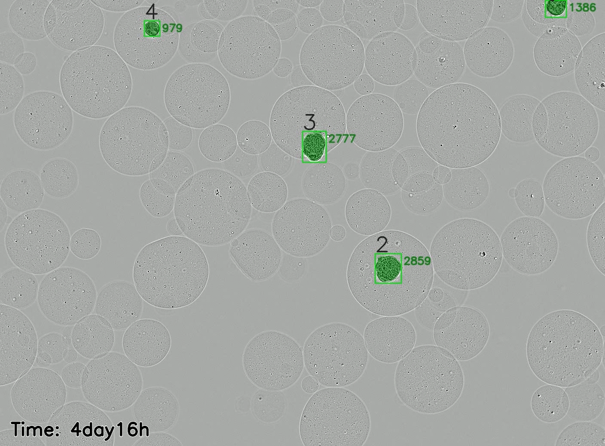
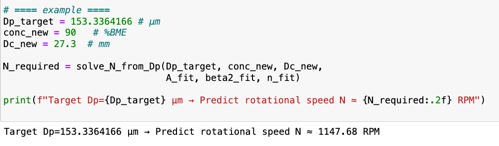

<h1 align="center">Droplet-culture</h1>


<p align="center">
  <strong>Official implementation of “Droplet culture of tumor organoids”</strong>

<p align="center">
  
  
  <!--  -->
</p>


The pipeline supports:

<ul>
<li>Droplet diameter pre-estimation based on conditions;</li>
<li>Organoid growth-tracking (Multi-object-tracking)</li>
<li>Organoid time course (Viability changing)</li>
</ul>

</p>


<h2>Overview</h2>


<h4> 1. Drop diameter prediction </h4>
<table>
  <thead>
    <tr>
      <th>Type</th>
      <th>Parameter</th>
      <th>Value (Example)</th>
    </tr>
  </thead>
  <tbody>
    <tr>
      <td rowspan="3"><b>Input</b></td>
      <td>Target diameter (<code>Dp_target</code>)</td>
      <td>153.3364 μm</td>
    </tr>
    <tr>
      <td>BME concentration (<code>conc_new</code>)</td>
      <td>90%</td>
    </tr>
    <tr>
      <td>Container diameter (<code>Dc_new</code>)</td>
      <td>27.3 mm</td>
    </tr>
    <tr>
      <td><b>Output</b></td>
      <td>Predicted rotational speed (<code>N</code>)</td>
      <td><b>≈ 1147.68 RPM</b></td>
    </tr>
  </tbody>
</table>


<h4>2. Oragnoid growth tracing</h4>

<p align="left">
  
</p>


<h4>3. Organoid time course </h4>

<h2>Installation</h2>

<p>
  This project uses the environment provided by
  <a href="https://github.com/JinLab-Westlake/Morphi-models">Morphi-models</a>.
</p>

<h3>1. Install Morphi-models</h3>

<pre><code>git clone https://github.com/JinLab-Westlake/Morphi-models.git
cd Morphi-models
bash install.sh
</code></pre>

<p>
  This will create a Conda environment named <code>morphi</code>
  and install all required dependencies.
</p>

<h3>2. Activate the environment</h3>

<pre><code>conda activate morphi
</code></pre>

<h3>3. Clone this repository</h3>

<pre><code>git clone https://github.com/JinLab-Westlake/Droplet-culture.git
cd Droplet-culture
</code></pre>

<p>
The directory will look like this:
</p>

<pre>
Morphi-models/
    ├── Droplet-culture/
    │    ├── Drop-diameter-pred/
    │    ├── Organoid-growth-tracking/
    │    └── Organoid-time_course/
    └── Morphi
         ├── Z-stack_projection/
         ├── Edge-detection/
         ├── DoANet/
         └── Instance-segment/
</pre>


<h2>Usage</h2>
<h4>1. Drop diameter prediction</h4>
<p align="left">
  
</p>
<h4>2. Oragnoid growth tracing</h4>
<pre>
Droplet-culture/
└── Organoid-time_course/
    ├── organoid-growth-tracking/   # acquire parent-child relationship for each frame
    │    └── Organoid-analysis/
    │        ├── preprocessing/
    │        └── inference/
    └── tracking_object             # parent-child relationship -> object-level trace  

</pre>

<!-- <h4>3. Organoid time course </h4>

Place the example image in the input path:
<pre>
Droplet-culture/
├── Organoid-time_course/
│   └── time-series_analysis.sh
└── docs/
    └── time-course/
        └── input/                  # input image path
            ├── WM29_P1_Day1.tiff
            ├── WM29_P1_Day2.tiff
            ├── WM29_P1_Day2.tiff
            └── ....
</pre>

Run directly with the following script:
<pre>
<code>cd Organoid-time_course
sh time-series_analysis.sh </code>
</pre>
 -->


<h2>Citation</h2>

If you use this code in your research, please cite our bioRxiv preprint:

```bibtex
@article{Xia2026,
  title   = {Droplet-based organoid screens enable high-throughput identification of cancer vulnerabilities},
  author  = {Ya-nan Xia, Yuting Sun, Yimin Wang and ...},
  journal = {bioRxiv},
  year    = {2026},
  doi     = {https://doi.org/10.64898/2026.10.13.744538}
}

